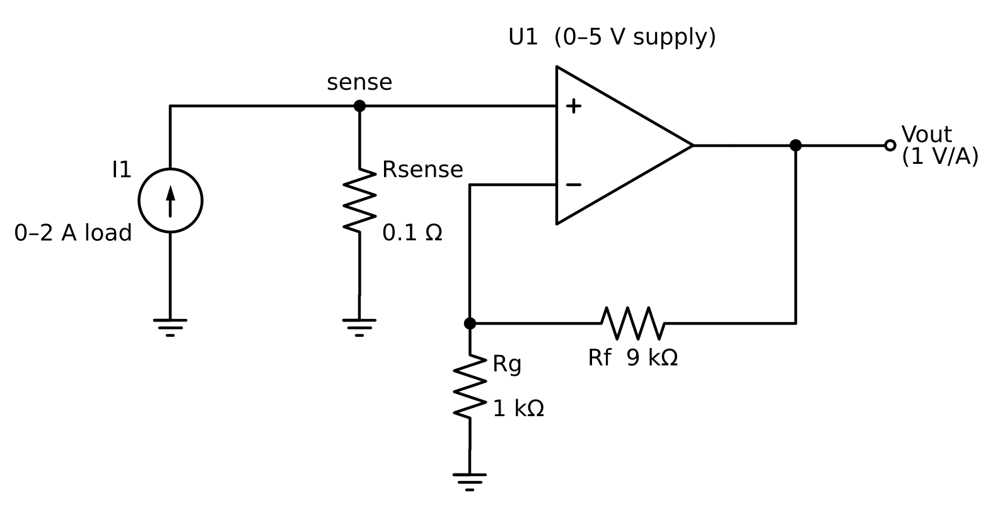
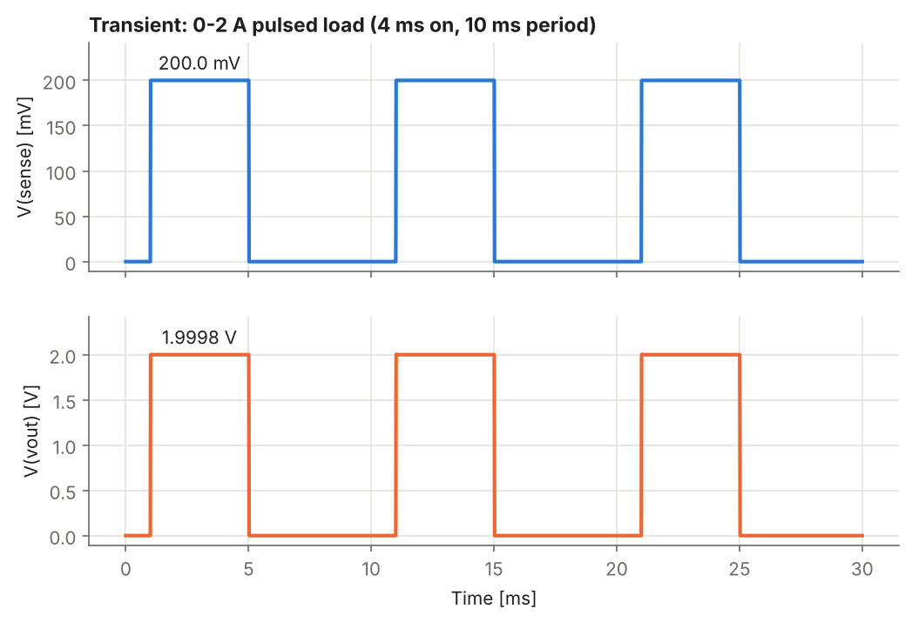
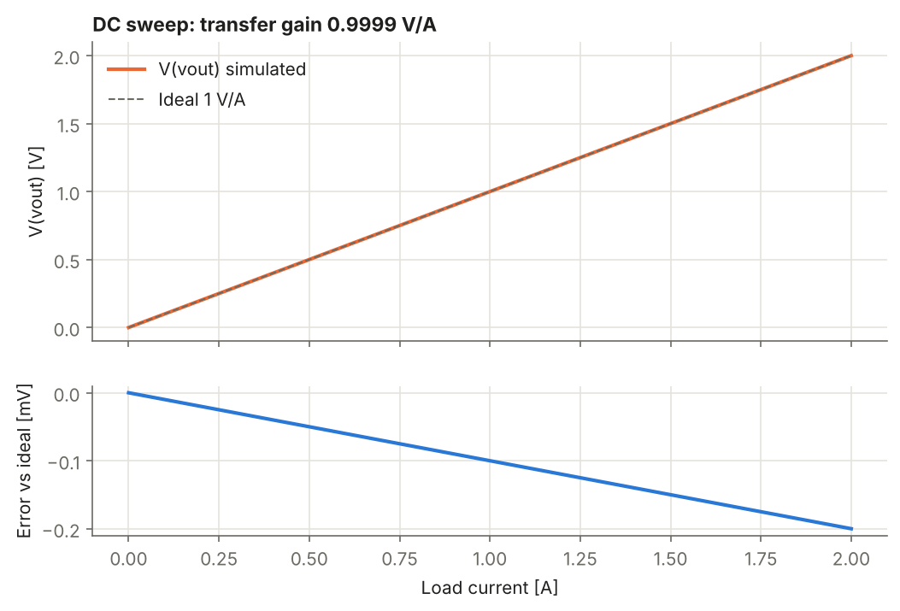
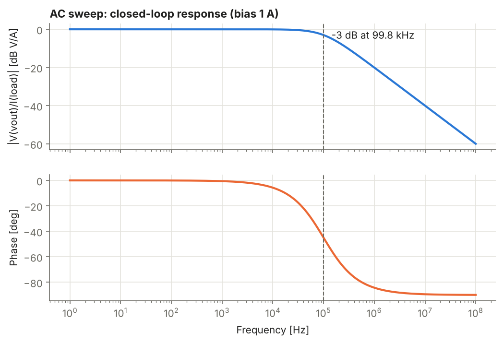

# Current-Sensing Front-End (LTspice)

A shunt-resistor current-sense front-end with a non-inverting op-amp amplifier (gain 10x), designed and simulated for low-power energy-monitoring applications such as smart-meter and mini-grid sensing nodes.

A load current is passed through a small sense resistor. The resulting millivolt-level drop is amplified to a level a microcontroller ADC can read, giving a transfer function of **1 V per amp** over a **0-2 A** range.

## Circuit



The load current flows through Rsense, and the resulting voltage V(sense) drives the op-amp's non-inverting input. The amplifier gain is set by Rf and Rg:

```
V(vout) = V(sense) x (1 + Rf/Rg) = V(sense) x (1 + 9k/1k) = 10 x V(sense)
```

| Component | Value | Purpose |
|---|---|---|
| Rsense | 0.1 Ω | Converts load current to a small voltage (100 mV per amp) |
| Rf | 9 kΩ | Feedback resistor, sets gain |
| Rg | 1 kΩ | Ground-leg resistor, sets gain |
| I1 | PULSE 0 A to 2 A, 4 ms on, 10 ms period | Simulated pulsed load |
| Op-amp | Single-pole model, 100 dB open-loop gain, 1 MHz GBW, 0-5 V single supply | See [Model and limitations](#model-and-limitations) |

## Design choices

**Gain of 10:** 2 A through 0.1 Ω gives 200 mV, which becomes 2.0 V at the output. That sits comfortably inside a 3.3 V or 5 V ADC range and leaves headroom for overcurrent readings.

**Shunt value:** a larger shunt gives more signal but wastes more power. At 2 A, 0.1 Ω dissipates P = I²R = 0.4 W, which is already significant for a low-power node. Dropping to 0.01 Ω would cut this to 40 mW but shrinks the signal to 20 mV, making op-amp offset voltage a much larger fraction of the reading. This is the central trade-off in current-sense design.

**Low-side sensing:** the shunt sits between the load and ground, so the amplifier input is referenced to ground and a simple non-inverting stage is enough. The cost is a small ground shift seen by the load, and no detection of faults that bypass the shunt.

## Simulation results

Reference simulations were run in ngspice using the netlists in `netlists/` (the same circuit and component values as the LTspice schematic). Full numbers are in [`results/summary.txt`](results/summary.txt).

| Metric | Result |
|---|---|
| Peak V(sense) at 2 A | 200 mV |
| V(vout) plateau at 2 A | 1.9998 V (finite open-loop gain error, about 0.01%) |
| DC transfer gain | 0.9999 V/A |
| Max DC error, 0-2 A sweep | 0.2 mV |
| Closed-loop -3 dB bandwidth | 99.8 kHz (≈ GBW / closed-loop gain = 1 MHz / 10) |

### Transient: pulsed load
V(vout) tracks the load current pulse with a constant 10x scaling of V(sense).



### DC sweep: linearity


### AC sweep: bandwidth


## How to reproduce

**LTspice:** open `schematic/current_sense.asc`, run the `.tran 30m` simulation, and probe `sense` and `vout`. The schematic pulls in the op-amp model with `.include ../netlists/opamp_1p.lib`, so keep the folder layout intact. Alternatively open any `.cir` file in `netlists/` directly in LTspice (File > Open, set the file type to `.cir`) and run it.

**ngspice (reference results):**

```bash
bash scripts/run_ngspice.sh        # runs the three netlists, writes results/data/
python3 scripts/plot_reference.py  # regenerates the plots and summary (needs numpy, matplotlib)
python3 scripts/draw_schematic.py  # redraws the schematic image (needs schemdraw: pip install schemdraw)
```

## Repository layout

```
netlists/    SPICE netlists: transient, DC sweep, AC sweep, and the op-amp model
schematic/   LTspice schematic (.asc) and schematic image (.png, .svg)
scripts/     ngspice runner, plotting script, and schematic drawing script
results/     plots and raw simulation data
```

## Model and limitations

- The op-amp is a behavioral model (single pole, clamped to a 0-5 V supply), not a manufacturer part. It captures gain, bandwidth, and output swing, but not input offset voltage, input bias current, noise, slew rate, or output current limits. These dominate real-world accuracy in a millivolt-level sensing stage.
- Sensing is unidirectional: current flowing the other way would try to drive the output below ground and would be clipped at 0 V.
- Resistors are ideal. In practice 1% tolerance on Rf and Rg alone gives a worst-case gain error of about 1.8%, before the shunt's own tolerance is added.

## Possible next steps

- Replace the behavioral model with a real precision op-amp or a dedicated current-sense amplifier and compare offset and noise behaviour
- Add an input-offset-voltage and resistor-tolerance Monte Carlo analysis
- Move to high-side sensing with a difference amplifier
- Add an RC output filter and model the ADC input
- Lay out the stage as a PCB in KiCad

## Tools

LTspice, ngspice, Python (NumPy, Matplotlib, schemdraw)
